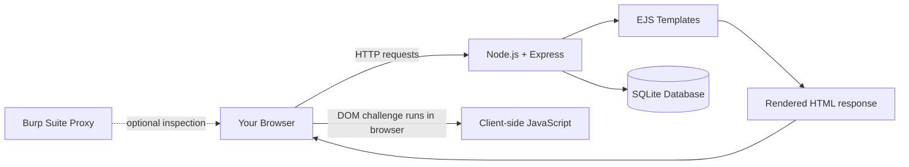

# XSS Vulnerability Lab — Architecture & Build Plan

A local, intentionally vulnerable web application for practicing Cross-Site Scripting (XSS) as a beginner bug bounty hunter.

> **Safety:** Use this lab only on your own computer. It binds to `127.0.0.1`. Do not expose it to the internet or test systems without authorization. Use harmless proof-of-execution payloads such as `alert()`; do not collect real credentials, cookies, or user data.

## 1. Architecture



### Components

| Component | Technology | Purpose |
|---|---|---|
| Browser | Brave / Chrome / Firefox | Interact with challenges and observe payload execution |
| Interception proxy | Burp Suite | Inspect and modify requests in the local lab |
| Web server | Node.js + Express | Handles routes and HTTP requests |
| Templates | EJS | Renders dynamic pages, including intentionally vulnerable output |
| Database | SQLite | Stores submitted comments for Stored XSS practice |
| Container (optional) | Docker Compose | Runs the lab in an isolated local container |

## 2. Challenges

| # | Challenge | Route | Learning objective |
|---|---|---|---|
| 1 | Reflected XSS | `/reflected?q=hello` | Trace a URL parameter into an HTML response |
| 2 | Stored XSS | `/stored` | Understand how saved user input can execute when rendered |
| 3 | DOM-based XSS | `/dom` | Trace URL fragment data into a browser DOM sink |
| 4 | Remediation | All routes | Fix the issue with context-appropriate output encoding and safe DOM APIs |

## 3. Project structure

```text
xss-vulnerability-lab/
├── server.js
├── package.json
├── Dockerfile
├── docker-compose.yml
├── README.md
├── .gitignore
├── lab.sqlite                 # created at runtime; ignored by Git
├── public/
│   └── style.css
└── views/
    ├── index.ejs
    ├── reflected.ejs
    ├── stored.ejs
    └── dom.ejs
```

## 4. Install and run

### Requirements

- Node.js 20 or newer
- npm

### Run locally

Open a terminal in the project directory:

```bash
npm install
npm start
```

Open the lab:

- Homepage: <http://127.0.0.1:3000>
- Reflected XSS: <http://127.0.0.1:3000/reflected?q=hello>
- Stored XSS: <http://127.0.0.1:3000/stored>
- DOM XSS: <http://127.0.0.1:3000/dom>

### Optional Docker setup

```bash
docker compose up --build
```

The Compose configuration binds port 3000 to `127.0.0.1`, not to every network interface.

## 5. Beginner practice workflow

1. Open one challenge and read the page.
2. Identify the **source** of input, such as a query parameter, form field, or URL fragment.
3. Find the **sink** where that input is used, such as HTML rendering or `innerHTML`.
4. Test with a harmless proof-of-execution payload, for example:

   ```html
   <script>alert('XSS')</script>
   ```

5. Observe the result in the browser and inspect the HTTP request and response with Burp Suite.
6. Record the source, sink, reproduction steps, impact, and recommended fix.
7. Patch the vulnerability and verify that the payload is displayed as text instead of executing.

For the DOM challenge, a controlled local test can use a URL fragment such as:

```text
http://127.0.0.1:3000/dom#
```

The URL fragment is processed by the browser and is not included in the HTTP request sent to the server.

## 6. Bug bounty hunter notes

| Question | What to investigate |
|---|---|
| Where does input enter? | Query parameters, form fields, URL fragments, headers, JSON |
| Where does it go? | HTML body, HTML attribute, JavaScript context, DOM sink |
| Does it execute? | Confirm only with a harmless proof-of-execution payload |
| Who is affected? | Only the submitting user, or another user who views stored content? |
| What is the impact? | Context and privileges of the affected user; avoid overstating severity |
| How should it be fixed? | Context-aware output encoding, safe DOM APIs, and appropriate sanitization when HTML is required |

## 7. Security reminders

- This project intentionally contains XSS vulnerabilities and is for training only.
- Keep the server bound to `127.0.0.1`.
- Do not deploy it to a public host or use real accounts and secrets.
- Do not test third-party websites unless their owner explicitly authorizes the testing.
- The training routes are not examples of secure production code.

## 8. Suggested next steps

- [ ] Complete Reflected XSS.
- [ ] Complete Stored XSS.
- [ ] Complete DOM-based XSS.
- [ ] Inspect requests and responses using Burp Suite.
- [ ] Write a short finding report for each challenge.
- [ ] Patch each vulnerability and retest.
